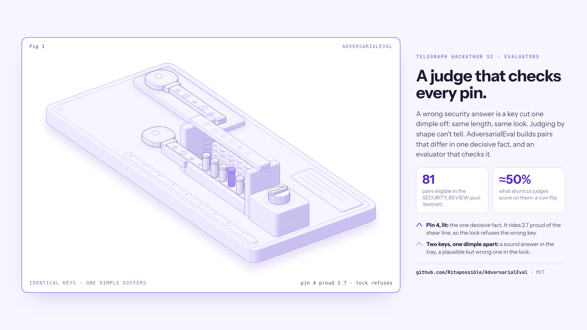
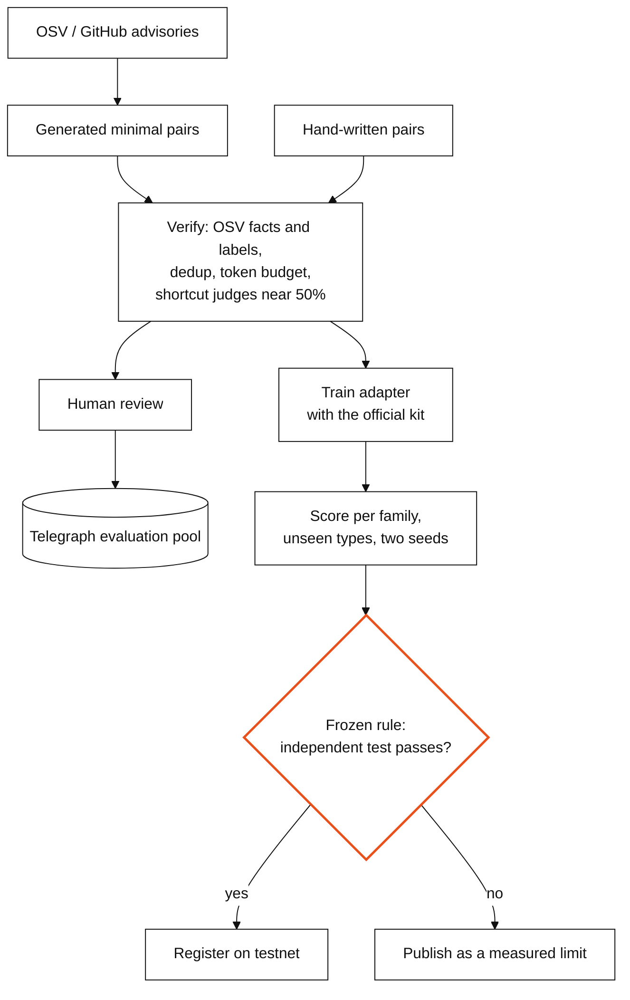

# AdversarialEval

**Making Telegraph's security answers trustworthy: evaluation material and an Evaluator adapter for the `SECURITY_REVIEW` intent, a paid benchmark of the live market, a free answer checker (Verified Ask), and a Mind that uses them to check dependencies before they ship.**

Telegraph Hackathon Season II · Evaluators track and Apps & Agents track (Mission 10, Model Economy) · Intent: `SECURITY_REVIEW` · Licence: MIT

**By track (judged separately): [Evaluators](tracks/evaluators.md) · [Apps & Agents](tracks/apps-and-agents.md) · [Miners](tracks/miners.md)**

**Live site: [adversarialeval.vercel.app](https://adversarialeval.vercel.app)** · **Mind: [Dependency.Guard](https://hellominds.ai/profile/minds/38266542-f36b-1410-8467-00039ce7df11)** (id `38266542-f36b-1410-8467-00039ce7df11`)

> **Disclosure.** This is a hackathon entry, and Season II awards prizes. The contributor
> wallet named below uploads evaluation material to `SECURITY_REVIEW_GENERAL`. The adapter's
> registration follows a decision rule fixed before any test data existed
> ([`eval/RULE-registration.md`](eval/RULE-registration.md)). Built with substantial AI
> assistance; see [`NOTICE.md`](NOTICE.md).



---

## The problem

On Telegraph, buyers pay miners for intelligence, and an **Evaluator adapter decides which
miner answers win** for each intent. For `SECURITY_REVIEW` (about 34 miners on testnet) that judge
decides which security advice reaches users. A wrong ranking hurts twice: the buyer acts on
bad advice, and the miners who checked their facts lose to the ones who didn't.

Wrong security answers are rarely obviously wrong. They are **plausible**, for example:
- citing a CVE id that doesn't exist, or one that belongs to a different package;
- calling a patched version vulnerable, or a vulnerable version safe;
- a confident "Secure" on vulnerable code, or a false alarm on safe code;
- a fix that a simple counterexample defeats.

A concrete case from our public data: for a .NET 6 API that parses request XML with
`XmlDocument`, one review flags XXE as critical; the other says it's safe, because
`XmlDocument`'s resolver is null by default on .NET Core and later. The second is correct,
yet the first is more alarming and uses more security vocabulary.

Judges that reward length, fluency or security keywords pick the wrong answer in cases like
this. On our material, those shortcut judges score about **50%**, a coin flip. The current
Canonical Evaluator for `SECURITY_REVIEW` scored **71.43%** on its hidden sample (15 of 21
pairs, testnet, 2026-11-10); one fewer correct pair would have missed the 70% floor. Measurement on this intent is weak, and the
material to test it properly is thin: the pool's active snapshot held 199 rows from 9
contributors before our upload.

## Our approach

AdversarialEval builds evaluation material in which each worse answer is **plausible but
wrong in one decisive, verifiable way**, with every advisory fact checked against OSV. It
contributes that material to the network's evaluation pool, so every adapter on the intent
is tested against these failure modes. It also trains and measures an adapter on it,
reporting results next to the shortcut judges the material is designed to defeat.

## Verified results

| Result | Evidence |
|---|---|
| **164 preference pairs eligible** in the live `SECURITY_REVIEW_GENERAL` pool (testnet), all *attested*: 81 uploaded 2026-11-14, 83 severity pairs 2026-11-18, contributor `0x31Cf…3095`. Rechecked with the node API on 2026-11-22. | [`2026-11-14-pool-upload.md`](eval/reports/2026-11-14-pool-upload.md), [`2026-11-18-pool-batch2.md`](eval/reports/2026-11-18-pool-batch2.md), [`raw API output`](eval/reports/raw/2026-11-22-evalpool-mine.json) |
| **Paid benchmark of the live market**, three rounds, 3,680 calls (rule pre-registered; payments matched to the chain or ledger): one miner beats a free OSV lookup in every round (pooled 83% vs 67%). The rank 1 miner scored **0/36** in rounds 2 and 3; in round 4 a rebuilt miner reached rank 1 with 17/36 and rank vs accuracy turned positive (τ = +0.02, −0.18, **+0.29**). | [`2026-11-22-rounds-2-4.md`](eval/reports/2026-11-22-rounds-2-4.md) |
| **Verified Ask**, replayed over 3,680 paid calls: **no wrong package answer was labelled verified** in any round, and 220 of 220 verified answers were correct. It also caught cited advisories about other packages, placeholder ids, and "Secure" on unpublished versions. | [`2026-11-22-verified-ask.md`](eval/reports/2026-11-22-verified-ask.md) |
| **Dependency.Guard Mind, with and without Telegraph** (26 package versions in 7 ecosystems, 2 of them non-existent): trusting Telegraph's routed answer passed **3 vulnerable versions** and called **2 non-existent packages "Secure"**; with Verified Ask, nothing unsafe was approved. The Mind on its own matched this by querying OSV directly, so a free lookup is the bar for known package vulnerabilities. | [`2026-11-22-mind-comparison.md`](eval/reports/2026-11-22-mind-comparison.md) |
| **Code review, pre-registered** (23 functions: 10 subtle flaws, their fixes, 3 safe decoys): Telegraph's route 13/23 and the best miner 11/23, both missing real flaws; the Mind 23/23, and shown the routed answers it overruled all 10 wrong ones. The same miner changed its verdict on 5 of 20 snippets asked 15 minutes apart. | [`2026-11-22-code-review-v2.md`](eval/reports/2026-11-22-code-review-v2.md) |
| Shortcut judges at chance on that material: longer-answer 54%, TF-IDF-to-prompt 54%, security-keyword 44%. | `scripts/check_data.sh` |
| Adapter: **72.4% / 74.7%** pairwise accuracy on 87 validation pairs (two seeds), versus ≤ 58% for every shortcut judge. | [`2026-11-11-cpu-v3-seed7.md`](eval/reports/2026-11-11-cpu-v3-seed7.md) |
| Held out from training, whole failure types are **not** learned: **37–39%** on unseen context-reversal and false-alarm pairs. Validation accuracy holds only for trained types. | [`2026-11-14-lofo.md`](eval/reports/2026-11-14-lofo.md) |
| Local rehearsal of the node's remote check (kit executor, real WASM engine, the node's own client): identity echo verified, and WASM and PyTorch scoring agree on **87/87** pairs. | [`2026-11-11-rehearsal-cpu-v3-seed13.md`](eval/reports/2026-11-11-rehearsal-cpu-v3-seed13.md) |
| A shortcut found and fixed: a model trained on hand-written pairs preferred any "vulnerable" answer (100% vs 0% on version pairs); balanced minimal pairs removed it. | [`2026-11-10-cpu-v1-seed7.md`](eval/reports/2026-11-10-cpu-v1-seed7.md) |

The adapter's accuracy figures are on same-author validation data; its registration decision
uses an independent test set, under the frozen rule. Benchmark and Mind results are on testnet,
with small samples; each report states its limits.

## Deliverables

| | Status |
|---|---|
| **Adversarial preference dataset** (264 training + 87 validation pairs, public) with a ten-family failure taxonomy ([`docs/ADVERSARIAL_CRITERIA.md`](docs/ADVERSARIAL_CRITERIA.md)) | Released in `data/public/`, `data/validation/` |
| **Evaluation-pool material** for `SECURITY_REVIEW_GENERAL`: OSV-verified, length-matched, human-reviewed | 164 eligible (81 + 83 severity pairs) |
| **Evaluator adapter**: LoRA + reward head on Telegraph's ModernBERT-base foundation, trained with the unmodified official kit | Passes Stage 1 locally; **not registered**, pending the independent test |
| **`CVE_LOOKUP_CVSS` truth source**: a keyless API giving NVD's CVSS score under one fixed rule ([`truth-sources/cve-cvss/`](truth-sources/cve-cvss/)) | Built and tested; deployment pending |
| **Verified Ask** ([`verify/`](verify/)): an API a buyer calls before trusting a security answer. It checks the verdict, the cited advisory ids and the version against OSV, deps.dev and rubygems.org, and returns verified, contradicted, unconfirmed, invalid or unchecked | Tested; replayed over rounds 2 to 4; hosted at `adversarialeval.vercel.app/api/verify` (token-protected) |
| **Dependency.Guard Mind** ([`mind/`](mind/)): on Minds by Animoca, it buys one ranked `SECURITY_REVIEW_GENERAL` answer per package through Anjoman, checks it with Verified Ask, re-asks one other provider only when the check proves it wrong, and returns PASS, BLOCK or FLAG with receipts; it re-checks approved versions daily | Live inside Minds; connector, evidence and comparison tests in the repo |
| **Paid market benchmark** ([`bench/`](bench/)): cost per verified correct answer, per miner, three rounds | Rounds 2 to 4 done, pooled report published |
| **"Spot the Flaw" demo**: pick the sound review of two, then see the flaw, the shortcut judges and the adapter's held-out choice ([`site/`](site/)) | Live at [adversarialeval.vercel.app](https://adversarialeval.vercel.app) |

## How it works



**Integrity measures**
- **Verified facts.** Every advisory id comes from OSV, trap ids are checked to be real or
  fabricated as declared, and every generated label is confirmed by OSV's own version query.
- **Minimal pairs.** Generated pairs differ in a single decisive fact, so surface cues can't
  separate them.
- **Shortcut judges reported with every result:** longer/shorter answer, prompt overlap,
  TF-IDF, security-keyword count. A set only enters the pool once they are near 50%.
- **Honest measurement.** Two seeds per result, held-out failure types, and a decision rule
  committed before the test data exists.
- **Privacy.** The pool set and its generator inputs are never published (`data/private/`
  is git-ignored), and nothing uses hidden evaluation rows.

## Getting started

Requirements: Python 3.10+, Go 1.25+ (Stage 1 check and executor), Node 18+ (truth source),
about 1 GB of disk (600 MB more for the foundation graph used by the rehearsal).

```bash
bash scripts/setup_kit.sh --tokenizer       # pinned official kit, foundation.json, node tokenizer
pip install -r third_party/telegraph-wasm-baseline/requirements.txt

bash scripts/check_data.sh                  # build, id checks, OSV label check, token budget, dedup, shortcut judges, kit gate
python tests/test_tools.py                  # data tools
python tests/test_bench.py && python tests/test_reproduce.py   # benchmark grading; published numbers reproduce
python tests/test_verify.py && python tests/test_mind.py      # Verified Ask; Mind test cases and scoring
node --test truth-sources/cve-cvss/test/select.test.js         # truth source

bash scripts/train.sh cpu-v3 --epochs 6 --lr 0.0002 --seed 7   # train with the kit, write a scored report
bash scripts/export.sh cpu-v3                                   # export the delta, run the node's Stage 1 check
bash scripts/setup_kit.sh --full && bash scripts/rehearse.sh cpu-v3   # local remote-check rehearsal
```

Training runs on CPU (about 40 minutes per seed at this data size). The full pipeline,
including hosting, registration and pool upload, is in [`docs/RUNBOOK.md`](docs/RUNBOOK.md).

**Verified Ask and the Mind**

```bash
echo '{"verdict":"Secure","vulnerability_count":0,"issues":[]}' | python -m verify --target pkg:npm/minimist@1.2.5
python -m verify.server                     # local HTTP API on 127.0.0.1:8402 (see verify/README.md)
(cd mind/connector && npm install)          # Node 22+
node mind/connector/guard.mjs --no-mind pkg:npm/minimist@1.2.5   # needs ANJOMAN_API_KEY; spends about $0.01 to $0.03 per package
```

Setting up the Mind inside Minds (keys, HTTP tool, the skill's instructions) is in
[`mind/README.md`](mind/README.md).

## Repository layout

| Path | Contents |
|---|---|
| `data/public/`, `data/validation/` | Released training and validation pairs (node format), sidecar metadata in `data/meta/` |
| `data/authoring/`, `data/sources/` | Authoring rows and verified OSV source records |
| `tools/` | Builders and checks: `build.py`, `gen_osv_pairs.py`, `check_ids.py`, `verify_generated.py`, `dedup.py`, review and upload tools |
| `eval/` | `score.py` (per-family scoring), `baselines.py` (shortcut judges), `reports/`, the frozen registration rule |
| `scripts/` | `setup_kit.sh`, `check_data.sh`, `train.sh`, `export.sh`, `rehearse.sh` |
| `truth-sources/cve-cvss/` | `CVE_LOOKUP_CVSS` truth source (serverless function, tests, YAML) |
| `verify/` | Verified Ask: checks (`core.py`), public sources with an evidence cache (`sources.py`), HTTP API (`server.py`), replay (`replay.py`) |
| `bench/` | Paid market benchmark: pre-registered rule, cases, runner, scorer, raw calls per round |
| `mind/` | Dependency.Guard: setup guide, connector (`connector/guard.mjs`), with/without-Telegraph tests (`compare.py`, `code_review_test.py`, `code-test-v2/`), and every run's evidence with receipts (`evidence/`) |
| `site/` | "Spot the Flaw" demo and benchmark summary, plus the hosted Verified Ask function (`site/api/verify.py`), served by Vercel (root directory `site`) |
| `deploy/` | Executor host setup (systemd unit, Caddy TLS, health check) |
| `tracks/` | One self-contained page per hackathon track: summary, results, evidence links, how to reproduce, limits |
| `docs/` | Research, taxonomy, dataset spec, runbook, reviewer guide, audit, submission checklist and evidence, demo script, forum post |

## Status and next steps

- **Done:** verified dataset and taxonomy; 164 pool pairs eligible on testnet; paid benchmark,
  rounds 2 to 4, with a pooled report; Verified Ask, tested and hosted; the Dependency.Guard
  Mind live in Minds, with with/without-Telegraph tests on packages and code; local Stage 1 and
  remote-check rehearsal; truth source built; site live. Progress posted on Mission 10
  ([#198](https://github.com/telegraphprotocol/bounties/issues/198)); evidence for each track in
  [`docs/SUBMISSION_EVIDENCE.md`](docs/SUBMISSION_EVIDENCE.md).
- **In progress:** the demo video; an independent test set from outside reviewers (20 of 40
  pairs); feedback from other Minds builders.
- **Decision pending:** adapter registration, only if the independent test meets the frozen
  bar (≥ 80% accuracy, Wilson lower bound ≥ 65%, every shortcut judge ≤ 60%).
- **Final submission:** through anjoman.ai when the form opens, by 1 Dec 2026, 23:59 UTC.

## Acknowledgements

- Telegraph's official adapter kit
  ([telegraph-wasm-baseline](https://github.com/telegraphprotocol/telegraph-wasm-baseline),
  MIT) and foundation model
  ([telegraph-foundation](https://github.com/telegraphprotocol/telegraph-foundation), from
  `answerdotai/ModernBERT-base`, Apache-2.0).
- Advisory data: the GitHub Advisory Database (CC BY 4.0) via [OSV](https://osv.dev), and
  NVD data (US government; not endorsed or certified by the NVD).
- Fexx ([@fexx301](https://github.com/fexx301)), for findings shared in the Evaluators
  community that shaped our held-out testing and severity-pair design, and for 20 independent,
  AI-assisted test pairs he checked by hand ([intake report](eval/reports/2026-11-18-test-intake-fexx.md)).
- defiplusacademy ([@defiplusacademy24-art](https://github.com/defiplusacademy24-art)), for 21
  AI-assisted test pairs, scored and reported separately as author-written pairs (not part of the
  independent test set) ([details](data/authoring/security_review/author_test/README.md)).
- Chrysolite494, for the guide to connecting a Mind to Anjoman
  ([SETUP.md](https://github.com/investor567768/telegraph-supplier-detective/blob/main/SETUP.md)).
- [Minds by Animoca Brands](https://hellominds.ai), where Dependency.Guard runs; package data
  from [deps.dev](https://deps.dev) and [rubygems.org](https://rubygems.org).

## Contributors

- **Rita** ([@Ritapossible](https://github.com/Ritapossible)): project lead

## Licence

MIT ([`LICENSE`](LICENSE)) for our code, documentation and preference pairs. Third-party
data keeps its own licence and attribution; see [`NOTICE.md`](NOTICE.md).
