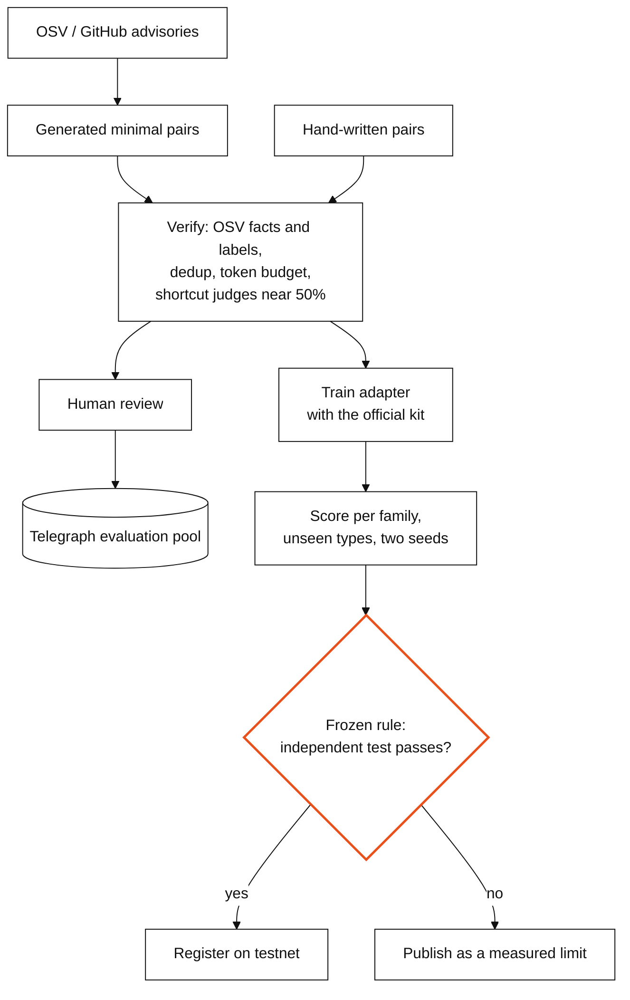

# AdversarialEval

**Checking paid AI answers before anyone acts on them.** On Telegraph, agents buy answers from
miners: is this package safe, is this code ready, which side of this market won. AdversarialEval
measures how often those answers are wrong, and builds the tools that stop a wrong answer from
becoming a decision:
- evaluation material and an Evaluator adapter for the `SECURITY_REVIEW` intent;
- a paid benchmark of the live market;
- a free answer checker (Verified Ask);
- **Dependency.Guard**, a Mind on Minds by Animoca that checks every paid answer against public
  sources before it ships, pays or settles anything.

Telegraph Hackathon Season II · **Evaluators** track and **Apps & Agents** track (Mission 10, Model Economy) · testnet · Licence: MIT

| | |
|---|---|
| Website | [adversarialeval.vercel.app](https://adversarialeval.vercel.app) · [demo videos](https://adversarialeval.vercel.app/videos) · [Spot the Flaw](https://adversarialeval.vercel.app/evaluators) |
| The app | [Dependency.Guard on Minds](https://hellominds.ai/profile/minds/38266542-f36b-1410-8467-00039ce7df11) (id `38266542-f36b-1410-8467-00039ce7df11`), listed on Anjoman |
| Per track (judged separately) | [Apps & Agents](tracks/apps-and-agents.md) · [Evaluators](tracks/evaluators.md) · [Miners](tracks/miners.md) |
| Dataset | [Hugging Face](https://huggingface.co/datasets/Ritapossible/adversarialeval-security-review) · [GitHub release v1.0](https://github.com/Ritapossible/AdversarialEval/releases/tag/dataset-v1.0) (zip with dataset card and checksums) · [`release/`](release/adversarialeval-security-review-v1/): 264 train, 87 validation, 40 independent test pairs |
| Evidence | every report signed and [anchored on Solana](https://explorer.solana.com/tx/2oUMB8Phnj98LWP2WzgxHwSvvmrRnVdvGDQXkMR4K3H5Vq2Q3mZMTn8W6RcU2J8pAE8pGQKzUqEWM9PvKhVskhvN?cluster=devnet) · [evidence index](docs/SUBMISSION_EVIDENCE.md) |

> **Disclosure.** This is a hackathon entry, and Season II awards prizes. The contributor wallet
> named below uploads evaluation material to `SECURITY_REVIEW_GENERAL`. The adapter's registration
> decision followed a rule fixed before any test data existed
> ([`eval/RULE-registration.md`](eval/RULE-registration.md)): it is **not registered**. Built with
> substantial AI assistance; see [`NOTICE.md`](NOTICE.md).


## Contents

- [The problem](#the-problem)
- [Results: Apps & Agents (Dependency.Guard)](#results-apps--agents-dependencyguard)
- [Results: Evaluators](#results-evaluators)
- [Evidence you can check](#evidence-you-can-check)
- [Demo videos](#demo-videos)
- [Deliverables](#deliverables)
- [How it works](#how-it-works)
- [Getting started](#getting-started)
- [Repository layout](#repository-layout)
- [Status](#status)
- [Acknowledgements](#acknowledgements) · [Citation](#citation) · [Licence](#licence)

## The problem

On Telegraph, buyers pay miners for intelligence, and an **Evaluator adapter decides which
miner answers win** for each intent. For `SECURITY_REVIEW` (about 34 miners on testnet) that judge
decides which security advice reaches users. A wrong ranking hurts twice: the buyer acts on
bad advice, and the miners who checked their facts lose to the ones who didn't.

Wrong security answers are rarely obviously wrong. They are **plausible**, for example:
- citing a CVE id that doesn't exist, or one that belongs to a different package;
- calling a patched version vulnerable, or a vulnerable version safe;
- a confident "Secure" on vulnerable code, or a false alarm on safe code;
- a fix that a simple counterexample defeats.

A concrete case from our public data: for a .NET 6 API that parses request XML with
`XmlDocument`, one review flags XXE as critical; the other says it's safe, because
`XmlDocument`'s resolver is null by default on .NET Core and later. The second is correct,
yet the first is more alarming and uses more security vocabulary.

Judges that reward length, fluency or security keywords pick the wrong answer in cases like
this. On our material, those shortcut judges score about **50%**, a coin flip. The current
Canonical Evaluator for `SECURITY_REVIEW` scored **71.43%** on its hidden sample (15 of 21
pairs, testnet, 2026-11-10); one fewer correct pair would have missed the 70% floor. Measurement on this intent is weak, and the
material to test it properly is thin: the pool's active snapshot held 199 rows from 9
contributors before our upload.

Paid answers have the same problem outside security reviews. Our benchmark and tests found:
- ranked miners at 0 of 36 in two of three rounds;
- malware approved 5 times in 21 Solana cases;
- each market-resolution provider alone settling 1 in 3 markets on the wrong side.

So the second half of this project checks any paid answer before acting on it.

## Results: Apps & Agents (Dependency.Guard)

Every rule and answer key was committed before the first paid call. Payments were matched to the
chain (x402 on Solana) or to Anjoman's ledger.

| Result | Evidence |
|---|---|
| **Paid benchmark of the live market**, three rounds, 3,680 calls (rule pre-registered; payments matched to the chain or ledger): one miner beats a free OSV lookup in every round (pooled 83% vs 67%). The rank 1 miner scored **0/36** in rounds 2 and 3; in round 4 a rebuilt miner reached rank 1 with 17/36 and rank vs accuracy turned positive (τ = +0.02, −0.18, **+0.29**). | [`2026-11-22-rounds-2-4.md`](eval/reports/2026-11-22-rounds-2-4.md) |
| **Verified Ask**, replayed over 3,680 paid calls: **no wrong package answer was labelled verified** in any round, and 220 of 220 verified answers were correct. It also caught cited advisories about other packages, placeholder ids, and "Secure" on unpublished versions. | [`2026-11-22-verified-ask.md`](eval/reports/2026-11-22-verified-ask.md) |
| **Dependency.Guard Mind, with and without Telegraph** (26 package versions in 7 ecosystems, 2 of them non-existent): trusting Telegraph's routed answer passed **3 vulnerable versions** and called **2 non-existent packages "Secure"**; with Verified Ask, nothing unsafe was approved. The Mind on its own matched this by querying OSV directly, so a free lookup is the bar for known package vulnerabilities. | [`2026-11-22-mind-comparison.md`](eval/reports/2026-11-22-mind-comparison.md) |
| **Code review, pre-registered** (23 functions: 10 subtle flaws, their fixes, 3 safe decoys): Telegraph's route 13/23 and the best miner 11/23, both missing real flaws; the Mind 23/23, and shown the routed answers it overruled all 10 wrong ones. The same miner changed its verdict on 5 of 20 snippets asked 15 minutes apart. | [`2026-11-22-code-review-v2.md`](eval/reports/2026-11-22-code-review-v2.md) |
| **Solana dependencies, pre-registered** (16 versions from the Solana stack, incl. the hijacked `@solana/web3.js` 1.95.7 and 2 that don't exist): every arm blocked all 7 bad versions; trusting Telegraph's verdict gave confident verdicts on **both non-existent versions** (14/16); with Verified Ask 16/16 for $0.22; the Mind alone 16/16. | [`2026-11-23-solana-dependencies.md`](eval/reports/2026-11-23-solana-dependencies.md) |
| **Solana use case 3, paid on Solana** (21 hard cases: real malware look-alikes, the other hijacked web3.js release, still-affected latest releases, 2026 advisories, never-published names; 55 Telegraph calls each paid in devnet USDC with x402 on Solana and confirmed on-chain): Telegraph's ranked answer trusted **6/21**, approving malware 5 times; first-listed provider 8/21; **ranked + Verified Ask 20/21, nothing unsafe approved, $0.35**; frontier model alone 21/21. | [`2026-11-24-solana-use-case-3.md`](eval/reports/2026-11-24-solana-use-case-3.md) |
| **Is Qwen-Agent safe to deploy?** Independent pre-deployment check of Alibaba's own agent framework (0.0.34, with its web UI): the release doesn't import after the documented install (undeclared `soundfile`); its pinned Gradio and capped Pillow leave 5 CRITICAL and 37 HIGH advisories reachable; the clean Gradio 6 upgrade breaks its UI; a forced Pillow 13 + Starlette 1.3.1 configuration serves with only 2 conditional advisories left. Decision: HOLD as shipped. | [`2026-11-25-qwen-agent-predeploy.md`](eval/reports/2026-11-25-qwen-agent-predeploy.md) |
| **Qwen alone vs Qwen + Telegraph** (Alibaba item 4, pre-registered): Qwen2.5-Coder-7B wrote 36 changes for 12 tasks; 30 should not ship. Qwen approved all 36 of its own; Telegraph's answers taken as returned decided 14 correctly; Dependency.Guard (paid answers checked, PyPI, OSV, a real install, tests) decided 27, blocked no good change, and caught a non-existent pin and PyJWT with 14 advisories that Telegraph called "Secure". All three missed 9 (a path traversal Qwen wrote 3 times). 45 answers paid on Solana, $0.45. | [`2026-11-28-qwen-code-verification.md`](eval/reports/2026-11-28-qwen-code-verification.md) |
| **Settling prediction markets on checked answers** (Solana use case, pre-registered): 24 markets with truth from Coinbase, NHL, MLB and USGS. Each provider on its own settled wrongly 1 time in 3; trusting Telegraph's ranked answer settled 3 markets on the wrong side, two agreeing independent providers 1 (a shootout win called a win "in regulation"); the resolution check settled none wrongly and got 21 of 24 right. 48 calls paid on Solana, $0.48. | [`2026-11-28-prediction-market-resolution.md`](eval/reports/2026-11-28-prediction-market-resolution.md) |
| **Real Polymarket markets** (24 resolved November markets, $180M traded, selected by rule): no paid answer settled wrongly, but Telegraph's ranked route settled only 6 of 24 and no paid answer settled any of the 6 midterm markets; the check settled all 6 crypto markets from Binance 1-minute candles, matching Polymarket, including a $6 near miss. 48 calls paid on Solana, $0.48. | [`2026-11-28-polymarket-resolution.md`](eval/reports/2026-11-28-polymarket-resolution.md) |
| **The same Polymarket markets through the app** (Anjoman + the Dependency.Guard Mind): 6 crypto markets settled from Binance, all correct; 18 held for a person; 0 wrong. Telegraph's answers through Anjoman gave an outcome for 1 of 24, and 7 timed-out asks were charged with no answer. The Mind's report kept to the evidence and flagged the $6 and $42 near misses. $0.61, reconciled with the escrow balance. | [`2026-11-28-polymarket-via-app.md`](eval/reports/2026-11-28-polymarket-via-app.md) |

## Results: Evaluators

| Result | Evidence |
|---|---|
| **164 preference pairs eligible** in the live `SECURITY_REVIEW_GENERAL` pool (testnet), all *attested*: 81 uploaded 2026-11-14, 83 severity pairs 2026-11-18, contributor `0x31Cf…3095`. Rechecked with the node API on 2026-11-22. | [`2026-11-14-pool-upload.md`](eval/reports/2026-11-14-pool-upload.md), [`2026-11-18-pool-batch2.md`](eval/reports/2026-11-18-pool-batch2.md), [`raw API output`](eval/reports/raw/2026-11-22-evalpool-mine.json) |
| Shortcut judges at chance on that material: longer-answer 54%, TF-IDF-to-prompt 54%, security-keyword 44%. | `scripts/check_data.sh` |
| Adapter: **72.4% / 74.7%** pairwise accuracy on 87 validation pairs (two seeds), versus ≤ 58% for every shortcut judge. | [`2026-11-11-cpu-v3-seed7.md`](eval/reports/2026-11-11-cpu-v3-seed7.md) |
| **Independent test** (40 pairs from 2 outside authors, frozen by hash, scored once): **77.5%** (95% CI 62.5 to 87.7%) versus at most 60% for every shortcut judge. Just under our pre-registered 80% bar, so the adapter is **not registered**. | [`2026-11-24-test-score.md`](eval/reports/2026-11-24-test-score.md) |
| Held out from training, whole failure types are **not** learned: **37–39%** on unseen context-reversal and false-alarm pairs. Validation accuracy holds only for trained types. | [`2026-11-14-lofo.md`](eval/reports/2026-11-14-lofo.md) |
| Local rehearsal of the node's remote check (kit executor, real WASM engine, the node's own client): identity echo verified, and WASM and PyTorch scoring agree on **87/87** pairs. | [`2026-11-11-rehearsal-cpu-v3-seed13.md`](eval/reports/2026-11-11-rehearsal-cpu-v3-seed13.md) |
| A shortcut found and fixed: a model trained on hand-written pairs preferred any "vulnerable" answer (100% vs 0% on version pairs); balanced minimal pairs removed it. | [`2026-11-10-cpu-v1-seed7.md`](eval/reports/2026-11-10-cpu-v1-seed7.md) |

The validation figures are on same-author data; the independent test (77.5%) is the figure to
quote. It missed our own registration bar, so the adapter is not registered. Benchmark and Mind
results are on testnet, with small samples; each report states its limits.

## Evidence you can check

| Result | Evidence |
|---|---|
| **Signed evidence:** every report and run file is fingerprinted and the list is signed (Ed25519); `node tools/evidence_manifest.mjs verify` (also run in CI) fails if any signed result changes. | [`evidence/`](evidence/) |
| **Evidence anchored on Solana**: the Ed25519-signed manifest of all 338 evidence files (reports, raw runs, payments) is hashed into a Solana devnet memo, so anyone can check the evidence existed unchanged on 28 Nov 2026. Check it with `node tools/anchor_evidence.mjs verify`. | [latest transaction](https://explorer.solana.com/tx/2oUMB8Phnj98LWP2WzgxHwSvvmrRnVdvGDQXkMR4K3H5Vq2Q3mZMTn8W6RcU2J8pAE8pGQKzUqEWM9PvKhVskhvN?cluster=devnet) · [`evidence/ANCHORS.json`](evidence/ANCHORS.json) |
| **How independent are the providers?** 37 miners are listed for `SECURITY_REVIEW_GENERAL`, but they pay out to 13 addresses, and two addresses run 26 of them; the 32 miners that answered in round 4 belong to 9 payout identities. | [`2026-11-24-provider-independence.md`](eval/reports/2026-11-24-provider-independence.md) |

## Demo videos

All five play on the website's [videos page](https://adversarialeval.vercel.app/videos), each with
a short description. The recordings are real; the narration is a synthetic voice.

| Video | Length | Also on |
|---|---|---|
| [Settling real Polymarket markets inside the Mind](https://adversarialeval.vercel.app/videos#polymarket-in-app) (live in the app, 28 Nov) | 1:11 | |
| [When a market settles on a paid AI answer, who checks it?](https://adversarialeval.vercel.app/videos#prediction-markets) (28 Nov) | 1:32 | [X](https://x.com/RitaCryptoTips/status/2126711423908614492) |
| [Qwen alone vs Qwen + Telegraph](https://adversarialeval.vercel.app/videos#qwen) (28 Nov) | 1:58 | [X](https://x.com/RitaCryptoTips/status/2126612379286786350) |
| [Dependency.Guard on Solana](https://adversarialeval.vercel.app/videos#solana) (live in the app, 25 Nov) | 0:47 | |
| [Dependency.Guard: a Mind that checks before it trusts](https://adversarialeval.vercel.app/videos#dependency-guard) (live in the app, 23 Nov) | 1:40 | |

## Deliverables

| | Status |
|---|---|
| **Dependency.Guard Mind** ([`mind/`](mind/)): on Minds by Animoca, it buys one ranked answer per question through Anjoman, checks it for free, re-asks one other provider only when the check proves it wrong, and returns PASS, BLOCK or FLAG (packages) or SETTLE or HOLD (markets) with receipts. Every PASS and BLOCK on record in the repo (the Mind's exported watchlist and every connector run) is re-checked free each day by the [`watch`](.github/workflows/watch.yml) job ([`mind/watch.py`](mind/watch.py)); its daily results are kept as workflow artifacts, and it fails on any alert. The `/api/guard` endpoint keeps the Anjoman key server-side so the Mind never holds it | Live inside Minds and listed on Anjoman; connectors `mind/connector/guard.mjs` (packages) and `markets.mjs` (prediction markets) |
| **Verified Ask** ([`verify/`](verify/)): an API a buyer calls before trusting a security answer. It checks the verdict, the cited advisory ids and the version against OSV, deps.dev and rubygems.org | Tested; replayed over rounds 2 to 4; hosted at `adversarialeval.vercel.app/api/verify` (token-protected) |
| **Paid market benchmark** ([`bench/`](bench/)): cost per verified correct answer, per miner, three rounds; Solana x402 runners and on-chain reconciliation | Rounds 2 to 4 done; Solana runs reconciled to the cent |
| **Code verification** ([`codeverify/`](codeverify/), [`deploycheck/`](deploycheck/)): a real install, tests, OSV and Bandit on AI-written code; a pre-deployment check for whole apps | Qwen code test and Qwen-Agent check done |
| **Market resolution** ([`resolve/`](resolve/)): official-source resolvers (Coinbase, Binance, NHL, MLB, USGS) and frozen market sets, including real Polymarket markets | Written-market, Polymarket and in-app runs done |
| **Adversarial preference dataset** with a ten-family failure taxonomy ([`docs/ADVERSARIAL_CRITERIA.md`](docs/ADVERSARIAL_CRITERIA.md)) | Release v1.0 in [`release/`](release/adversarialeval-security-review-v1/) (dataset card, checksums); source splits in `data/` |
| **Evaluation-pool material** for `SECURITY_REVIEW_GENERAL`: OSV-verified, length-matched, human-reviewed | 164 eligible (81 + 83 severity pairs) |
| **Evaluator adapter**: LoRA and a reward head on Telegraph's ModernBERT-base foundation, trained with the unmodified official kit | Passes Stage 1 locally; independent test 77.5% (our bar 80%); **not registered** |
| **`CVE_LOOKUP_CVSS` truth source** ([`truth-sources/cve-cvss/`](truth-sources/cve-cvss/)): a keyless API giving NVD's CVSS score under one fixed rule | Built and tested; not deployed (not pursued for this submission) |
| **Signed evidence** ([`evidence/`](evidence/), [`tools/evidence_manifest.mjs`](tools/evidence_manifest.mjs), [`tools/anchor_evidence.mjs`](tools/anchor_evidence.mjs)) | 338 files signed; anchored on Solana devnet; checked in CI |
| **Website** ([`site/`](site/), built from [`site-src/`](site-src/) by `tools/build_site.py`): six pages (overview, Evaluators with "Spot the Flaw", Dependency.Guard, the benchmark, evidence and limits, videos), with a mobile menu | Live at [adversarialeval.vercel.app](https://adversarialeval.vercel.app) |

## How it works



**Integrity measures**
- **Verified facts.** Every advisory id comes from OSV, trap ids are checked to be real or
  fabricated as declared, and every generated label is confirmed by OSV's own version query.
- **Minimal pairs.** Generated pairs differ in a single decisive fact, so surface cues can't
  separate them.
- **Shortcut judges reported with every result:** longer/shorter answer, prompt overlap,
  TF-IDF, security-keyword count. A set only enters the pool once they are near 50%.
- **Honest measurement.** Two seeds per result, held-out failure types, and a decision rule
  committed before the test data exists.
- **Privacy.** The pool set and its generator inputs are never published (`data/private/`
  is git-ignored), and nothing uses hidden evaluation rows.

For a paid answer, the same idea is one step: buy the answer, check it against the public source
that settles it, then decide. Never act on an answer the check can't confirm.

## Getting started

Requirements: Python 3.10+, Node 22+ (it reads `NODE_USE_ENV_PROXY` behind a proxy), Go 1.25+ (the Stage 1 check and executor only), and about
1 GB of disk (600 MB more for the foundation graph used by the rehearsal).

**Offline checks** (no keys, no spending), the same steps CI runs:

```bash
bash scripts/ci_local.sh                    # every CI step: tests, data checks, site, signed evidence, connectors
node tools/evidence_manifest.mjs verify     # every signed result is unchanged
NODE_PATH=bench/node_modules node tools/anchor_evidence.mjs verify   # the Solana anchor matches the evidence
```

**Evaluators: data and adapter**

```bash
bash scripts/setup_kit.sh --tokenizer       # pinned official kit, foundation.json, node tokenizer
pip install -r third_party/telegraph-wasm-baseline/requirements.txt
bash scripts/check_data.sh                  # build, id checks, OSV label check, token budget, dedup, shortcut judges, kit gate
bash scripts/train.sh cpu-v3 --epochs 6 --lr 0.0002 --seed 7   # train with the kit, write a scored report
bash scripts/export.sh cpu-v3                                   # export the delta, run the node's Stage 1 check
python tools/build_release.py               # rebuild the dataset release (refuses on any overlap with the private pool)
```

**Apps: Verified Ask, the Mind and the tests**

```bash
echo '{"verdict":"Secure","vulnerability_count":0,"issues":[]}' | python -m verify --target pkg:npm/minimist@1.2.5
(cd mind/connector && npm install)
node mind/connector/guard.mjs --no-mind pkg:npm/minimist@1.2.5   # needs an Anjoman key; about $0.01 to $0.03 per package
python codeverify/score.py score && python resolve/run.py score  # Qwen and market scores from the saved answers
```

Behind a proxy, run Node with `NODE_USE_ENV_PROXY=1`. Setting up the Mind inside Minds (keys, the
HTTP tool, the skill's instructions) is in [`mind/README.md`](mind/README.md); the full pipeline,
including hosting and pool upload, is in [`docs/RUNBOOK.md`](docs/RUNBOOK.md).

## Repository layout

| Path | Contents |
|---|---|
| `mind/` | Dependency.Guard: setup guide, connectors (`connector/guard.mjs`, `connector/markets.mjs`), with/without-Telegraph tests, every run's evidence with receipts (`evidence/`) |
| `verify/` | Verified Ask: checks, public sources with an evidence cache, HTTP API, replay |
| `bench/` | Paid market benchmark: pre-registered rules, cases, runners (Anjoman and Solana x402), scorer, raw calls, on-chain reconciliation |
| `codeverify/`, `deploycheck/` | Qwen code test (frozen tasks, visible and hidden tests, checker) and the pre-deployment checker |
| `resolve/` | Prediction-market resolution: official-source resolvers, frozen market sets (written and Polymarket), rules, scorer |
| `data/`, `release/` | Training, validation and test pairs with metadata; the published dataset release |
| `tools/` | Data builders and checks, the site builder, the release builder, evidence signing and the Solana anchor |
| `eval/` | Scoring, shortcut judges, the frozen registration rule, every report (`reports/`) |
| `evidence/` | Signed manifest, signature, public key, Solana anchors |
| `scripts/` | Kit setup, data checks, training, export, rehearsal, `ci_local.sh` |
| `site/`, `site-src/` | The website (generated) and its sources; hosted Verified Ask function |
| `truth-sources/cve-cvss/` | `CVE_LOOKUP_CVSS` truth source |
| `tracks/`, `docs/` | One page per hackathon track; research, taxonomy, dataset spec, runbook, submission checklist and evidence |

## Status

As of 28 Nov 2026:
- **Apps & Agents:** Dependency.Guard is live in Minds and listed on Anjoman. Every test above is
  done, reported and signed, with the evidence anchored on Solana.
- **Evaluators:** 164 pool rows are eligible. The dataset is released (v1.0). The adapter scored
  77.5% on the independent test and is not registered, because it missed our own bar.
- **Progress:** posted on Mission 10 ([#198](https://github.com/telegraphprotocol/bounties/issues/198))
  and in the Discord #showcase thread.
- **Final submission:** through anjoman.ai by 1 Dec 2026, 23:59 UTC
  ([checklist](docs/SUBMISSION_CHECKLIST.md)).

## Acknowledgements

- Telegraph's official adapter kit
  ([telegraph-wasm-baseline](https://github.com/telegraphprotocol/telegraph-wasm-baseline),
  MIT) and foundation model
  ([telegraph-foundation](https://github.com/telegraphprotocol/telegraph-foundation), from
  `answerdotai/ModernBERT-base`, Apache-2.0).
- Advisory data: the GitHub Advisory Database (CC BY 4.0) via [OSV](https://osv.dev), and
  NVD data (US government; not endorsed or certified by the NVD).
- Fexx ([@fexx301](https://github.com/fexx301)), for findings shared in the Evaluators
  community that shaped our held-out testing and severity-pair design, and for 20 independent,
  AI-assisted test pairs he checked by hand ([intake report](eval/reports/2026-11-18-test-intake-fexx.md)).
- Lino, for 20 independent, AI-assisted test pairs (drafted with Grok; he read and revised every
  pair by hand) that completed the 40-pair independent test set
  ([test result](eval/reports/2026-11-24-test-score.md)).
- defiplusacademy ([@defiplusacademy24-art](https://github.com/defiplusacademy24-art)), for 21
  AI-assisted test pairs, scored and reported separately as author-written pairs (not part of the
  independent test set) ([details](data/authoring/security_review/author_test/README.md)).
- Chrysolite494, for the guide to connecting a Mind to Anjoman
  ([SETUP.md](https://github.com/investor567768/telegraph-supplier-detective/blob/main/SETUP.md)).
- [Minds by Animoca Brands](https://hellominds.ai), where Dependency.Guard runs; package data
  from [deps.dev](https://deps.dev) and [rubygems.org](https://rubygems.org).

## Contributors

- **Rita** ([@Ritapossible](https://github.com/Ritapossible)): project lead

## Citation

```
@misc{adversarialeval2026,
  title  = {AdversarialEval: checking paid AI answers before anyone acts on them},
  author = {Rita (Ritapossible)},
  year   = {2026},
  url    = {https://github.com/Ritapossible/AdversarialEval}
}
```

## Licence

MIT ([`LICENSE`](LICENSE)) for our code, documentation and preference pairs. Third-party data
keeps its own licence and attribution; see [`NOTICE.md`](NOTICE.md).
