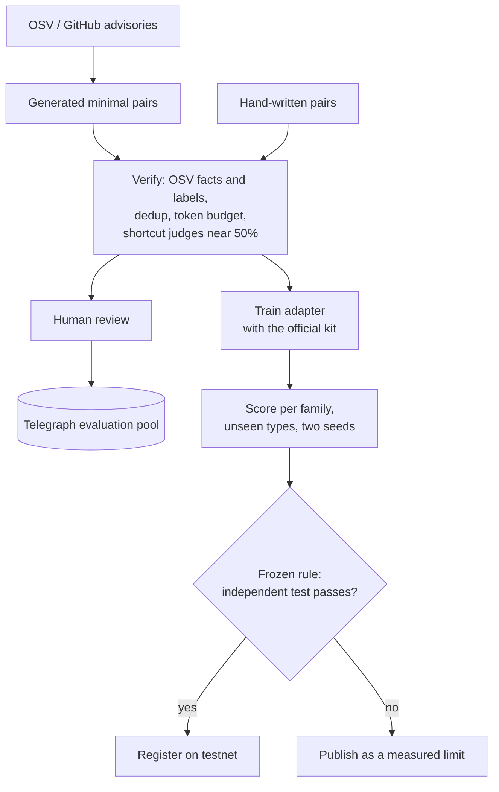

# AdversarialEval

**Adversarial evaluation material and an Evaluator adapter for Telegraph's `SECURITY_REVIEW` intent: measuring whether a security answer survives scrutiny, not whether it sounds convincing.**

Telegraph Hackathon Season II · Evaluators track · Intent: `SECURITY_REVIEW` · Licence: MIT

> **Disclosure.** This is a hackathon entry, and Season II awards prizes. The contributor
> wallet named below uploads evaluation material to `SECURITY_REVIEW_GENERAL`. The adapter's
> registration follows a decision rule fixed before any test data existed
> ([`eval/RULE-registration.md`](eval/RULE-registration.md)). Built with substantial AI
> assistance; see [`NOTICE.md`](NOTICE.md).


---

## The problem

On Telegraph, buyers pay miners for intelligence, and an **Evaluator adapter decides which
miner answers win** for each intent. For `SECURITY_REVIEW` (32 miners on testnet) that judge
decides which security advice reaches users. A wrong ranking hurts twice: the buyer acts on
bad advice, and the miners who checked their facts lose to the ones who didn't.

Wrong security answers are rarely obviously wrong. They are **plausible**, for example:
- citing a CVE id that doesn't exist, or one that belongs to a different package;
- calling a patched version vulnerable, or a vulnerable version safe;
- a confident "Secure" on vulnerable code, or a false alarm on safe code;
- a fix that a simple counterexample defeats.

A concrete case from our public data: for a .NET 6 API that parses request XML with
`XmlDocument`, one review flags XXE as critical; the other says it's safe, because
`XmlDocument`'s resolver is null by default on .NET Core and later. The second is correct,
yet the first is more alarming and uses more security vocabulary.

Judges that reward length, fluency or security keywords pick the wrong answer in cases like
this. On our material, those shortcut judges score about **50%**, a coin flip. The current
Canonical Evaluator for `SECURITY_REVIEW` scored **71.43%** on its hidden sample (15 of 21
pairs, testnet, 2026-11-10); one fewer correct pair would have missed the 70% floor. Measurement on this intent is weak, and the
material to test it properly is thin: the pool's active snapshot held 199 rows from 9
contributors before our upload.

## Our approach

AdversarialEval builds evaluation material in which each worse answer is **plausible but
wrong in one decisive, verifiable way**, with every advisory fact checked against OSV. It
contributes that material to the network's evaluation pool, so every adapter on the intent
is tested against these failure modes. It also trains and measures an adapter on it,
reporting results next to the shortcut judges the material is designed to defeat.

## Verified results

| Result | Evidence |
|---|---|
| **81 preference pairs eligible** in the live `SECURITY_REVIEW_GENERAL` pool (testnet), all *attested*, uploaded 2026-11-14, contributor `0x31Cf…3095`. Bounty #96 evaluation-material part submitted and moved to review. | Node API output in [`eval/reports/2026-11-14-pool-upload.md`](eval/reports/2026-11-14-pool-upload.md) |
| Shortcut judges at chance on that material: longer-answer 54%, TF-IDF-to-prompt 54%, security-keyword 44%. | `scripts/check_data.sh` |
| Adapter: **72.4% / 74.7%** pairwise accuracy on 87 validation pairs (two seeds), versus ≤ 58% for every shortcut judge. | [`2026-11-11-cpu-v3-seed7.md`](eval/reports/2026-11-11-cpu-v3-seed7.md) |
| Held out from training, whole failure types are **not** learned: **37–39%** on unseen context-reversal and false-alarm pairs. Validation accuracy holds only for trained types. | [`2026-11-14-lofo.md`](eval/reports/2026-11-14-lofo.md) |
| Local rehearsal of the node's remote check (kit executor, real WASM engine, the node's own client): identity echo verified, and WASM and PyTorch scoring agree on **87/87** pairs. | [`2026-11-11-rehearsal-cpu-v3-seed13.md`](eval/reports/2026-11-11-rehearsal-cpu-v3-seed13.md) |
| A shortcut found and fixed: a model trained on hand-written pairs preferred any "vulnerable" answer (100% vs 0% on version pairs); balanced minimal pairs removed it. | [`2026-11-10-cpu-v1-seed7.md`](eval/reports/2026-11-10-cpu-v1-seed7.md) |

All accuracy figures above are on same-author validation data. The registration decision
uses an independent test set, under the frozen rule.

## Deliverables

| | Status |
|---|---|
| **Adversarial preference dataset** (264 training + 87 validation pairs, public) with a ten-family failure taxonomy ([`docs/ADVERSARIAL_CRITERIA.md`](docs/ADVERSARIAL_CRITERIA.md)) | Released in `data/public/`, `data/validation/` |
| **Evaluation-pool material** for `SECURITY_REVIEW_GENERAL`: OSV-verified, length-matched, human-reviewed | 81 eligible; 84 severity pairs in review |
| **Evaluator adapter**: LoRA + reward head on Telegraph's ModernBERT-base foundation, trained with the unmodified official kit | Passes Stage 1 locally; **not registered**, pending the independent test |
| **`CVE_LOOKUP_CVSS` truth source**: a keyless API giving NVD's CVSS score under one fixed rule ([`truth-sources/cve-cvss/`](truth-sources/cve-cvss/)) | Built and tested; deployment pending |
| **"Spot the Flaw" demo**: pick the sound review of two, then see the flaw, the shortcut judges and the adapter's held-out choice ([`site/`](site/)) | Built; public hosting pending |

## How it works



**Integrity measures**
- **Verified facts.** Every advisory id comes from OSV, trap ids are checked to be real or
  fabricated as declared, and every generated label is confirmed by OSV's own version query.
- **Minimal pairs.** Generated pairs differ in a single decisive fact, so surface cues can't
  separate them.
- **Shortcut judges reported with every result:** longer/shorter answer, prompt overlap,
  TF-IDF, security-keyword count. A set only enters the pool once they are near 50%.
- **Honest measurement.** Two seeds per result, held-out failure types, and a decision rule
  committed before the test data exists.
- **Privacy.** The pool set and its generator inputs are never published (`data/private/`
  is git-ignored), and nothing uses hidden evaluation rows.

## Getting started

Requirements: Python 3.10+, Go 1.25+ (Stage 1 check and executor), Node 18+ (truth source),
about 1 GB of disk (600 MB more for the foundation graph used by the rehearsal).

```bash
bash scripts/setup_kit.sh --tokenizer       # pinned official kit, foundation.json, node tokenizer
pip install -r third_party/telegraph-wasm-baseline/requirements.txt

bash scripts/check_data.sh                  # build, id checks, OSV label check, token budget, dedup, shortcut judges, kit gate
python tests/test_tools.py                  # 15 tests
node --test truth-sources/cve-cvss/test/select.test.js   # 6 tests

bash scripts/train.sh cpu-v3 --epochs 6 --lr 0.0002 --seed 7   # train with the kit, write a scored report
bash scripts/export.sh cpu-v3                                   # export the delta, run the node's Stage 1 check
bash scripts/setup_kit.sh --full && bash scripts/rehearse.sh cpu-v3   # local remote-check rehearsal
```

Training runs on CPU (about 40 minutes per seed at this data size). The full pipeline,
including hosting, registration and pool upload, is in [`docs/RUNBOOK.md`](docs/RUNBOOK.md).

## Repository layout

| Path | Contents |
|---|---|
| `data/public/`, `data/validation/` | Released training and validation pairs (node format), sidecar metadata in `data/meta/` |
| `data/authoring/`, `data/sources/` | Authoring rows and verified OSV source records |
| `tools/` | Builders and checks: `build.py`, `gen_osv_pairs.py`, `check_ids.py`, `verify_generated.py`, `dedup.py`, review and upload tools |
| `eval/` | `score.py` (per-family scoring), `baselines.py` (shortcut judges), `reports/`, the frozen registration rule |
| `scripts/` | `setup_kit.sh`, `check_data.sh`, `train.sh`, `export.sh`, `rehearse.sh` |
| `truth-sources/cve-cvss/` | `CVE_LOOKUP_CVSS` truth source (serverless function, tests, YAML) |
| `site/` | "Spot the Flaw" demo page |
| `deploy/` | Executor host setup (systemd unit, Caddy TLS, health check) |
| `docs/` | Research, taxonomy, dataset spec, runbook, reviewer guide, audit, submission checklist |

## Status and next steps

- **Done:** verified dataset and taxonomy; pool material eligible on testnet; bounty #96
  claimed, evaluation-material part submitted; local Stage 1 and remote-check rehearsal;
  truth source and demo built.
- **In progress:** an independent test set from outside reviewers; the second pool batch
  (severity pairs).
- **Decision pending:** adapter registration, only if the independent test meets the frozen
  bar (≥ 80% accuracy, Wilson lower bound ≥ 65%, every shortcut judge ≤ 60%).

## Acknowledgements

- Telegraph's official adapter kit
  ([telegraph-wasm-baseline](https://github.com/telegraphprotocol/telegraph-wasm-baseline),
  MIT) and foundation model
  ([telegraph-foundation](https://github.com/telegraphprotocol/telegraph-foundation), from
  `answerdotai/ModernBERT-base`, Apache-2.0).
- Advisory data: the GitHub Advisory Database (CC BY 4.0) via [OSV](https://osv.dev), and
  NVD data (US government; not endorsed or certified by the NVD).
- Fexx ([@fexx301](https://github.com/fexx301)), for findings shared in the Evaluators
  community that shaped our held-out testing and severity-pair design.

## Contributors

- **Rita** ([@Ritapossible](https://github.com/Ritapossible)): project lead

## Licence

MIT ([`LICENSE`](LICENSE)) for our code, documentation and preference pairs. Third-party
data keeps its own licence and attribution; see [`NOTICE.md`](NOTICE.md).
